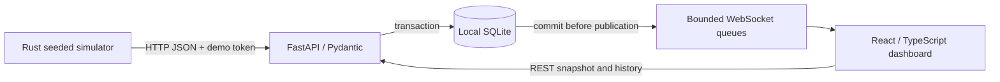

# Prototype architecture

The README is the product specification. This implementation retains the telemetry path
and adds stateful physiology, durable operations and a complete synthetic examination.
It does not complete all assurance/integration milestones. See [implementation status](implementation-status.md).

Run one API worker and one controlled Rust worker for the three crew and seven virtual instruments. The API serializes
ingestion and commits raw packet data, normalized observations and alert evidence in
one SQLAlchemy transaction. A database uniqueness constraint also protects device
sequence numbers. Alembic owns schema changes; startup fails if the schema is missing.
Queries use short synchronous SQLite sessions; a server database and async driver
are outside this local prototype's scope. SQLite is local persistence, not a backup.

The trust boundary is the laptop. Bind API and Vite to loopback; ingestion requires
`X-Demo-Token`. The checked-in default token is a local demonstration setting, not
a shared deployment credential. Read APIs expose synthetic records without roles.
Only the configured origin is allowed for browser REST/WS clients. DEMO is the only
supported application mode; schemas reject real identities and non-simulated sources.
The Rust CLI also restricts its destination to loopback. The common DeviceAdapter seam
has only a SimulatedAdapter; no physical-device integration exists. Operator writes are
restricted to loopback and trusted browser origins; they do not implement clinician roles.

Startup does not assume acquisition: records received before this API instance started
are HISTORICAL. Device freshness uses both source and receipt times. The backend sends
status heartbeats every second; the UI expires readings locally using server clock
offset and closes a silent stream after five seconds. Reconnection subscribes first,
buffers events while loading REST snapshots, then merges by observation ID and sequence.
Each stream queue is bounded; overflow closes the client with 1013 to force a resnapshot.
There is no persistent event log or multi-worker pub/sub; REST is the recovery source.

This supports operation without Internet once dependencies are installed, while the
local API is running. It does not provide PWA caching or a ground synchronization queue.
Ground sync is explicitly shown as NOT IMPLEMENTED and is separate from sensor status.

Rust owns all synthetic numerical physiology and waveform generation. The API stores
desired controls, worker heartbeat/acknowledgment and model checkpoints. REST controls
never pretend a worker is present. Pause freezes logical time without refreshing values.
Restart playback makes a new run; restarting the API pauses controls and marks earlier
telemetry historical. Accepted packets contain model checkpoints for Rust restart recovery.

Examination adapters create durable acquisition requests. Rust returns event-only BP,
lab or bone-density fixtures through the existing validated telemetry transaction. The
result reaches REVIEW before an explicit SAVE. A lost worker produces a timeout, not
a replacement result. Meal/inventory transactions, fitness, EVA, tasks and acknowledgment
use typed demo operation records in the same SQLite database. See [operations](operations.md)
and [simulation model](simulation-model.md).

Dependencies follow the [FastAPI WebSocket documentation](https://fastapi.tiangolo.com/advanced/websockets/)
and the [Vite development workflow](https://vite.dev/guide/). This is a research prototype,
not a medical device or certified flight software.
