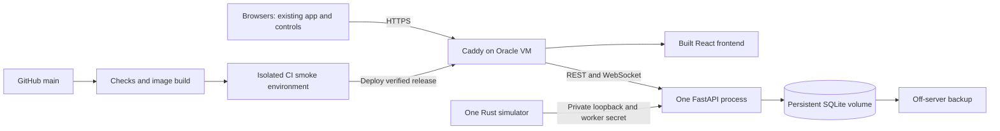

# Oracle web publishing and synchronization plan

Status: proposed plan, revised for the user's existing Oracle Free Tier VM.
Server access and the public hostname have not yet been supplied.

## Agreed scope

- Reuse the existing Oracle server for the full application.
- Keep the same frontend: screens, layout, styling, navigation, controls, red
  alerts, sound effects, and yellow-and-black mood faces.
- Add no operator login, roles, permission-aware frontend, or read-only visitor mode.
- Keep existing demo interactions usable through the public URL.
- Automatically publish tested GitHub updates and share application data across devices.
- Continue using synthetic data exclusively.

This is one shared, publicly interactive demo. Anyone with its URL can change
scenarios, acknowledge alerts, and update demo records through the existing
controls. Those changes are visible to other visitors. Separate visitor sessions
are outside this release. The previous protected-operator proposal is superseded.

## Target architecture



Run Caddy, FastAPI, and Rust with Docker Compose. Only the gateway publishes
HTTP/HTTPS ports. The simulator shares the API container's network namespace to
preserve its existing loopback-only destination restriction. Keep one API process
and one simulator for the shared database and in-memory WebSocket subscriptions.

Use the current SQLite schema on a persistent volume. Database files, secrets,
and runtime history stay outside Git and container images. No database-service
or frontend-framework migration is required for this release.

Caddy serves the production frontend build and proxies `/api/v1`, preserving its
path and WebSocket upgrades, through the same HTTPS origin. See
[Caddy reverse proxy](https://caddyserver.com/docs/caddyfile/directives/reverse_proxy)
and [automatic HTTPS](https://caddyserver.com/docs/automatic-https).

## 1. Inspect the existing Oracle server

Establish the following with read-only checks before changing the VM:

- SSH host/alias, OS, CPU architecture, RAM, free disk, and existing workloads.
- Instance shape and current Always Free eligibility in the Oracle Console.
- Public IP, subnet routing, OCI security rules, and the host firewall.
- Existing services on ports 80/443, Docker availability, and persistent storage.
- Intended public hostname and access to its DNS settings.

Oracle offers both AMD and Arm-based Always Free shapes, so the Rust binary and
container images must match the existing instance. Inspect the actual allocation
rather than assuming a particular free CPU/memory allowance. See
[Oracle Always Free resources](https://docs.oracle.com/en-us/iaas/Content/FreeTier/freetier_topic-Always_Free_Resources.htm).

Build artifacts in CI, using native target builds or a verified cross-build setup
once the architecture is known. Keep smoke/staging checks in CI initially, avoiding
a second always-running stack on a small free VM. A temporary on-server staging
stack is optional only if measured capacity permits it.

Deliverable: a server inventory and matching deployment target.

## 2. Make the same application work on the web

- Run the existing checks and resolve failures before adding deployment automation.
- Replace `frontend/vite.config.ts`'s implicit `GITHUB_ACTIONS` repository subpath
  with an explicit asset-base setting; use `/` for the hosted application.
- Serve `frontend/dist` rather than running Vite's development server publicly.
- Preserve the frontend's same-origin `/api/v1` REST and WebSocket connections.
- Set the backend's allowed origin to the exact public HTTPS application origin.
- Add an explicit backend public-demo deployment profile. Allow existing browser
  mutations without operator authentication in that profile, retaining request
  validation and same-origin browser checks. Preserve local-only behavior for
  local development.
- Configure trusted proxy handling deliberately. Do not rely on making remote
  clients appear to be localhost to bypass the current mutation guard. See
  [FastAPI proxy guidance](https://fastapi.tiangolo.com/advanced/behind-a-proxy/).
- Keep runtime, heartbeat, physiology ingestion, and radiation ingestion private
  to the worker. Retain token validation and block those public gateway routes.
- Generate a deployment worker secret instead of using `local-demo-only`; keep
  it outside frontend bundles and `VITE_*` variables.
- Retain bounded payloads and appropriate request/import/WebSocket limits for
  the VM's capacity, without introducing login or role-based interface restrictions.

Deliverable: the existing interactive app works at its public URL, while worker
internals remain private. No operator-control system is introduced.

## 3. Synchronize records across devices

- Use the hosted API and SQLite volume as the shared source of truth.
- Reuse telemetry WebSockets, snapshot/reconnect recovery, and the two-second
  polling of operational records.
- Persist completed reaction practice results through a typed API instead of
  browser storage alone. Keep the existing display and interactions; only their
  persistence wiring changes. Store mission/crew identity, completion time,
  response timings, and false-start/missed-cue counts.
- Keep selected crew and audio preferences local to each browser.
- Keep radiation records vehicle-wide, without a crew association.
- Retain stale-revision rejection for simulator controls. Use appropriate
  conditional updates where simultaneous visitors could overwrite records.
- Start with a fresh hosted seed. Import laptop history only if requested,
  preserving validated event IDs and provenance.

Deliverable: the same accepted records appear on a phone and laptop and survive
refresh and service restarts. Public interactions affect the same shared demo.

Offline bidirectional database replication and spacecraft-to-ground synchronization
remain separate future features. Runtime data travels through the API, not Git.

## 4. Package the services and persistence

- Add production Dockerfiles, `.dockerignore`, Compose configuration, a Caddyfile,
  and environment examples containing placeholders only.
- Use architecture-matched gateway, API, and Rust images.
- Keep SQLite on a persistent volume with defined ownership.
- Apply Alembic migrations once before the API serves a release.
- Add restart policies, graceful shutdown, and readiness checks.
- Preserve simulator checkpoints. API startup currently pauses playback and changes
  the control revision, so deployment must deliberately restore the intended
  running/paused state after migration and worker readiness.
- Verify fresh telemetry and worker heartbeat, beyond the API health response.
- Measure telemetry/ECG storage growth and implement safe retention, preserving
  saved reports, alert evidence, provenance, and database references.
- Schedule consistent backups outside the VM and verify restoration with the
  [SQLite backup mechanism](https://sqlite.org/backup.html).
- Account for Oracle's documented possibility of reclaiming idle Always Free
  instances in availability expectations and backup procedures. See
  [Oracle's resource policy](https://docs.oracle.com/en-us/iaas/Content/FreeTier/freetier_topic-Always_Free_Resources.htm).

Deliverable: service redeployment preserves accepted records and demo state.

## 5. Configure Oracle networking and HTTPS

- Point the selected hostname at the VM's public address.
- Allow TCP 80/443 in the applicable OCI security rules and host firewall,
  accounting for existing services and preserving required system rules.
- Keep SSH access scoped to the administration/deployment path.
- Publish gateway ports only; keep the API port and worker endpoints private.
- Verify HTTPS renewal, redirects, REST requests, and WebSocket upgrades.

Both OCI network rules and the instance firewall affect reachability. See Oracle's
[web-server tutorial](https://docs.oracle.com/en/learn/lab_compute_instance/)
and [compute networking guidance](https://docs.oracle.com/en-us/iaas/Content/Security/Reference/compute_security.htm).

Deliverable: a public HTTPS hostname serving the same application.

## 6. Automatically publish GitHub updates

```text
Push/merge to main
  -> tests and contract checks for that commit
  -> architecture-matched images tagged with the commit SHA
  -> GitHub Container Registry
  -> isolated full-stack smoke checks in CI
  -> serialized deployment to the existing Oracle VM
  -> migration, readiness, and live telemetry verification
```

- Gate deployment on successful checks. The current Pages workflow runs separately
  from full CI and only publishes the frontend.
- Use a dedicated deployment identity and GitHub environment secrets.
- Deploy tested image digests rather than rebuilding different images on the VM.
- Keep CI smoke-test data separate from the public persistent database.
- Back up before migrations, serialize releases, and avoid overlapping publishers.
- Retain the previous release and a rollback procedure. Prefer compatible schema
  changes; reverting images alone cannot reverse an incompatible migration.
- Replace the application-only Pages deployment with the Oracle deployment.
  A separate Pages presentation page remains optional.

See GitHub's [image publishing](https://docs.github.com/en/actions/tutorials/publish-packages/publish-docker-images)
and [deployment environment](https://docs.github.com/en/actions/concepts/workflows-and-actions/deployment-environments)
documentation.

Deliverable: tested updates on `main` automatically reach the Oracle-hosted app.

## 7. Verify the hosted release

- Check the existing layout and workflows on a laptop and phone.
- Verify controls work without login: scenario changes, acknowledgment, mood
  submissions, examinations, and normal demo record updates.
- Confirm accepted changes appear in another browser and concurrent updates
  receive appropriate conflict handling.
- Check telemetry freshness, reconnects, vehicle radiation, and synced reaction results.
- Verify red alerts, audio enable/mute on HTTPS, and yellow mood faces.
- Verify worker-only endpoints cannot be reached through the public gateway.
- Test service/VM restart, deployment persistence, backups, restoration, and rollback.
- Retain synthetic-data labels and DEMO-only validation.

## Planned repository work

- Production container, Compose, gateway, and deployment configuration.
- `.github/workflows/` — checked builds, isolated smoke tests, Oracle deployment.
- `frontend/vite.config.ts` — explicit deployment base path.
- Backend public-demo profile and shared reaction-result storage.
- Frontend reaction persistence plumbing, with no redesign or control gating.
- Hosted-origin, private-worker-route, synchronization, migration, and recovery tests.
- An Oracle deployment/backup/restore runbook.

## Details needed to implement

1. SSH host/alias and user, using an already configured local key or deployment identity.
2. OS, architecture, memory/disk, and existing workloads; inspect these over SSH.
3. Desired public hostname and DNS access.
4. Intended history retention and approximate concurrent audience.

Private key contents stay outside chat and Git. Provider selection and operator
account setup are no longer outstanding: Oracle is selected, and operator
authentication is omitted by request.
