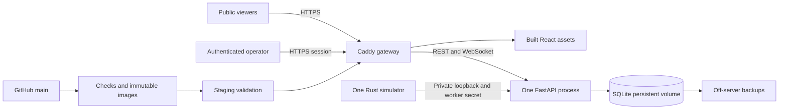

# Web publishing and synchronization plan

Status: proposed implementation plan. No infrastructure has been provisioned by this task.

## Agreed scope

- Publish a public, read-only demonstration of Memento Mori.
- Protect operator controls with authentication and server-side permissions.
- Automatically publish tested GitHub updates.
- Share application records and live telemetry across browsers and devices.
- Preserve the current interface layout, red alerts, sound controls, and yellow mood faces.
- Continue using synthetic data exclusively.

The first release has one shared demo mission. An authenticated operator controls
the scenario that all visitors see. Anonymous visitors can browse observations
and records, but cannot restart the simulator, acknowledge shared alerts, save
check-ins, import datasets, or change shared records. Independent visitor
playgrounds would require separate demo-session isolation and are a later feature.

## Findings from the current repository

| Existing behavior | Required publishing work |
| --- | --- |
| `.github/workflows/pages.yml` builds and publishes `frontend/dist`. | Deploy the API and simulator as well as static assets. The workflow's existence does not verify that a deployment has succeeded. |
| Pages publishing runs independently of `.github/workflows/ci.yml`. | Gate releases on successful checks for the exact commit being deployed. |
| `frontend/vite.config.ts` selects a repository subpath whenever `GITHUB_ACTIONS` is set. | Make the asset base explicit for root-domain hosting; keep a Pages subpath only where needed. |
| The frontend uses same-origin `/api/v1` REST requests and a same-origin WebSocket. | Serve the application, API, and stream through one HTTPS origin. |
| FastAPI operator checks trust loopback clients and a browser origin. | Add real operator identity and authorization before exposing mutations. Proxying remote requests through loopback must not grant operator access. |
| Rust only sends to loopback API destinations. | Keep the simulator alongside the API in a private, shared network namespace. |
| SQLite is the only supported database; WebSocket subscribers are held in process memory. | Start with one API process, one simulator, and durable local storage. |
| Operational records already poll every two seconds; telemetry uses WebSockets and REST resynchronization. | Reuse these paths for shared cloud records and reconnect recovery. |
| Reaction practice results are stored only in browser local storage. | Add server persistence if those results must sync between devices. |
| API startup pauses playback and advances its control revision. | Include deliberate checkpoint/resume behavior in the deployment procedure. |
| Telemetry history currently grows without a retention policy. | Measure growth and implement safe retention and disk monitoring before continuous hosting. |

GitHub Pages supports static publishing and does not run Python server applications.
It cannot host this complete live stack by itself. See [GitHub Pages documentation](https://docs.github.com/en/pages/getting-started-with-github-pages/creating-a-github-pages-site).

The Sites skill was also reviewed. Its documented server runtime is Cloudflare
Workers rather than a native Python/Rust process environment. Hosting the full
current stack there would require an architectural rewrite or a separately hosted
backend. It remains an option for a separate presentation/landing page.

## Recommended initial architecture

Use one always-on Linux virtual server, a custom hostname, and Docker Compose.
Start with a modest server size, then select capacity from measured memory use,
telemetry storage growth, and the intended concurrent audience. Provider and
monthly budget remain to be selected; no price commitment is assumed.



Deployment units:

1. **Gateway:** Caddy serves the built frontend, terminates HTTPS, and proxies
   `/api/v1` including WebSocket upgrades. Only public gateway ports are exposed.
2. **API:** one FastAPI worker on the private application network, with its SQLite
   directory mounted on a persistent volume. No public API port mapping.
3. **Simulator:** a release-built Rust worker sharing the API container's network
   namespace, keeping `127.0.0.1` connectivity and the existing destination restriction.
4. **Persistence:** a dedicated database volume, separate staging data, and backups
   outside the server. Runtime records never enter Git or container images.

Caddy supports WebSocket proxying and automatic HTTPS; production configuration
must preserve the `/api/v1` prefix and allow SPA navigation fallback. See
[Caddy reverse proxy](https://caddyserver.com/docs/caddyfile/directives/reverse_proxy)
and [automatic HTTPS](https://caddyserver.com/docs/automatic-https).

Configure trusted proxy headers explicitly and keep the allowed browser origin
equal to the HTTPS application origin. IP addresses and forwarded headers are
network metadata, not operator authentication. See
[FastAPI proxy guidance](https://fastapi.tiangolo.com/advanced/behind-a-proxy/).

## Implementation sequence

### 1. Establish the release baseline

- Run the existing backend, frontend, simulator, contract, integration, and browser checks.
- Fix any failures before enabling deployment automation; do not assume current CI is green.
- Separate local/web deployment configuration while keeping `SIMULATED` data validation.
- Replace the implicit `GITHUB_ACTIONS` asset-base behavior with an explicit build setting.
- List the public read endpoints, operator mutations, and worker-only endpoints.

Deliverable: a passing baseline and a documented deployment configuration contract.

### 2. Protect operator actions

- Add operator login, using a configured identity provider and an allowlist of operators.
  GitHub OAuth is a practical initial option; provider selection and account setup
  are deployment inputs rather than assumptions about existing credentials.
- Use server-managed sessions with secure, HttpOnly cookies and CSRF protection.
- Require operator permissions on every mutation, including alert acknowledgment,
  check-ins, examinations, simulator controls, datasets, meals, and EVA/fitness actions.
- Make the public interface read-only using returned permissions; keep server checks
  authoritative even when a visitor manually calls an endpoint.
- Preserve browser-local actions such as selecting crew, minimizing a warning,
  muting audio, and practicing reaction timing.
- Keep runtime, heartbeat, physiology ingestion, and radiation ingestion private to
  the worker. Deny their public gateway access, retaining worker-token validation.
- Replace the default worker token with a deployment secret, never a `VITE_*` value.
- Bound public reads, imports, request sizes, and WebSocket connection rates.

Deliverable: anonymous browsing works; unauthenticated and unauthorized writes fail;
an allowlisted operator can demonstrate the complete workflow.

### 3. Complete cross-device data synchronization

- Use the hosted API and database as the authoritative shared state.
- Retain existing telemetry WebSockets, bounded queues, snapshot recovery, and
  two-second operational polling. Do not claim instantaneous updates for polled records.
- Add typed API storage for completed reaction tests with mission/crew identity,
  completion time, response timings, and false-start/missed-cue counts. Persist
  completed results through authenticated operator writes and read them across devices.
- Keep audio preference and selected crew local to each browser. These are interface
  preferences rather than shared mission records.
- Keep radiation records associated with the vehicle, without a crew identifier.
- Continue rejecting stale control revisions. Add appropriate revisions or conditional
  updates for records where concurrent operator edits could otherwise overwrite changes.
- Define a fresh hosted seed as the default launch state. If existing laptop history is
  needed, make a one-time, validated import with original event IDs and provenance.

Deliverable: a phone and laptop see the same accepted records; temporary disconnects
recover through snapshots without duplicate records or false LIVE indicators.

This phase covers online shared-state synchronization. Offline bidirectional laptop
replication and spacecraft-to-ground store-and-forward synchronization require a
separate conflict, identity, and delivery protocol and are outside the first release.

### 4. Package and operate the services

- Add production Dockerfiles, `.dockerignore`, Compose configuration, a Caddyfile,
  and environment examples containing placeholders only.
- Build the frontend and Rust binary in build stages; use production API serving
  rather than Vite's development server.
- Add startup ordering and a single Alembic migration step before the API accepts traffic.
- Configure restart policies and graceful simulator/API shutdown.
- Preserve the run/checkpoints across releases. Restore the intended running or
  paused state deliberately after migration and worker readiness; do not start a new
  run on every deployment or leave a previously running public demo paused accidentally.
- Add readiness checks for fresh worker heartbeat and telemetry, beyond the existing
  API/database health endpoint. Alert on process failure, disk growth, and stale acquisition.
- Establish configurable retention for raw waveforms and routine telemetry. Archive
  or prune only with a policy that preserves alert evidence, saved examinations,
  provenance, and database references.
- Schedule consistent SQLite backups and perform a restore drill. Use SQLite's
  backup mechanism rather than copying an actively changing database file blindly.
  See [SQLite backup documentation](https://sqlite.org/backup.html).

Deliverable: a staging stack that survives browser refresh, worker restart, API
restart, and service redeployment while preserving accepted records.

### 5. Automate GitHub-to-web publishing

Proposed release path:

```text
Push/merge to main
  -> checks for that commit
  -> build images tagged with the commit SHA
  -> publish to GitHub Container Registry
  -> deploy the same images to isolated staging
  -> HTTPS, authorization, WebSocket, persistence, and browser smoke checks
  -> deploy those tested image digests to the public demo
  -> verify fresh telemetry and record the deployed version
```

- Extend the existing workflows so deployment depends on checks, rather than
  publishing the frontend independently on every push.
- Keep staging and public-demo data and secrets separate. The public demo has
  exactly one active API and simulator pair; never run overlapping publishers.
- Use GitHub environments for deployment secrets and branch restrictions. Normal
  successful releases can be automatic, as requested; any manual release gate
  would be an explicit later preference.
- Pin deployment credentials to the required repository/environment permissions.
- Perform a pre-migration backup and serialized deployment; reject overlapping releases.
- Retain the previous image digests and a rollback procedure. Prefer compatible
  schema changes: rolling back code alone cannot undo an incompatible migration.
- Replace the current Pages application deployment with the full-stack release.
  A Pages project may instead host a presentation page that links to the live demo.

GitHub documents [publishing container images](https://docs.github.com/en/actions/tutorials/publish-packages/publish-docker-images)
and [deployment environments](https://docs.github.com/en/actions/concepts/workflows-and-actions/deployment-environments).

Deliverable: a tested commit on `main` reaches the public demo automatically, with
an identifiable deployed SHA and a working rollback procedure.

### 6. Launch and verify the public demo

- Configure the chosen domain's DNS, HTTPS, deployment secrets, and operator allowlist.
- Check that the public demo runs independently of the development laptop.
- Verify anonymous reads and denied writes, authenticated operator actions, and
  rejection of direct requests that bypass disabled interface controls.
- Verify REST, WebSocket reconnects, radiation freshness, persisted mood/reaction
  records, examination review/save/export, and red alert sound controls on HTTPS.
- Check laptop and phone synchronization, simultaneous viewers, and two operator
  sessions attempting conflicting edits.
- Test backup restoration, previous-release rollback, simulator loss, and API restart.
- Keep the interface's synthetic-data labels visible; publish only synthetic demo records.

Deliverable: a working public HTTPS URL and a short operator/deployment runbook.

## Planned repository changes

- `docs/web-publishing-plan.md` — this plan.
- Production container/Compose/gateway files and deployment environment examples.
- `.github/workflows/` — gated build, staging, release, and rollback automation.
- `frontend/vite.config.ts` — explicit asset-base configuration.
- Backend authentication, permissions, shared reaction-result storage, and web-profile settings.
- Frontend permission-aware actions and server-backed reaction history, preserving layout.
- Authorization, reconnect, persistence, migration, deployment, and cross-device tests.
- Operations documentation for secrets, retention, backup, restore, and operator use.

## Decisions needed before provisioning

1. Hosting provider/account, region, and monthly budget ceiling.
2. Public hostname and access to its DNS settings.
3. Identity provider and the operator accounts to allow.
4. Expected concurrent audience and how long demo history should be retained.

These choices affect provisioning details, not the agreed public-viewer/protected-operator
model or the requirement to synchronize both releases and shared application records.

## Later scaling

Keep one API process for the first release. Multiple API workers would need a
shared event-distribution mechanism for WebSockets; PostgreSQL would require
changes to the SQLite-specific connection, queries, and migrations. Introduce
those together when measured load or availability requirements justify scaling.
